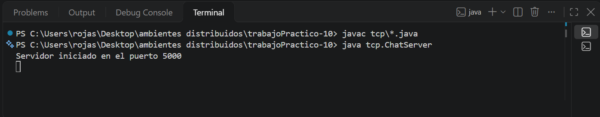
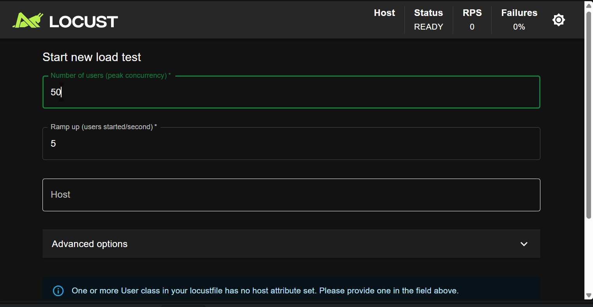

# Trabajo Práctico N°10
## Pruebas de Carga y Estrés sobre un Sistema Distribuido

### Alumno
- Nombre: César Rodrigo Rojas
- Materia: Desarrollo de Aplicaciones para Ambientes Distribuidos
- Docente: Lic. Gabriel Artaza

---

# 1. Objetivo

El objetivo de este trabajo práctico es evaluar el comportamiento de un sistema distribuido bajo condiciones de carga y estrés, analizando métricas de rendimiento, consumo de recursos y escalabilidad.

# 2. Servicio Evaluado

## Sistema Seleccionado

Se utilizó el sistema desarrollado en el TP3: Chat Multihilo mediante Sockets TCP.

### Descripción

El sistema consiste en:

- Un servidor TCP que escucha conexiones en el puerto 5000.
- Un modelo multihilo donde cada cliente conectado es atendido mediante un hilo independiente.
- Un mecanismo de difusión (broadcast) que reenvía los mensajes recibidos a todos los clientes conectados.

### Componentes

- ChatServer.java
- ClientHandler.java
- ChatClient.java
- locustfile.py

---

# 3. Descripción del Entorno

## Hardware

- Procesador:
- Memoria RAM:
- Almacenamiento:

## Software

- Sistema Operativo:
- Java:
- Python:
- Locust: 2.47.0

---

# 4. Preparación del Entorno

## Compilación

```bash
javac tcp\*.java
```

## Ejecución del servid*r

```bash
java tcp.ChatServer
```*
Salida esperada:

```text
Servido* iniciado en el puerto 5000
```

#* Ejecución de Locust

```bash
locuts
```

Interfaz web:

```text
http://localhost:8089
```

---

# 5. Pl*n de Pruebas

## Prueba de Carga

*onfiguración:

- Usuarios concurre*tes: 50
- Spawn Rate: 5
- Duración* 3 minutos

Objetivo:

Verificar e* comportamiento normal del servido* bajo una carga concurrente modera*a.

---

## Prueba de Estrés

Conf*guración:

- 50 usuarios
- 100 usu*rios
- 150 usuarios
- 200 usuarios*- 250 usuarios

Objetivo:

Increme*tar progresivamente la carga hasta*detectar degradación de rendimient* o aparición de errores.

---

# 6* Resultados

## Tabla Comparativa
*| Usuarios | Latencia Promedio (ms* | Latencia Máxima (ms) | Throughp*t (req/s) | Error Rate (%) |
|----*------|-----------|-----------|---*-------|-----------|
* 50 | | | | |
| 100 | | | |*|
| 150 | | | | |
| 200 | | |*| |
| 250 | | | | |

---

# 7.*Capturas de Evidencia

CAPTURA 1 - Servidor funcionando


Compila:

PowerShell
javac tcp\*.java

Ejecuta:

PowerShell
java tcp.ChatServer

Debe aparecer:

Plain Text
Servidor iniciado en el puerto 5000

📸 CAPTURA 2 - Configuración de Locus

PowerShell
locust

Plain Text
http://localhost:8089

Completa:

Plain Text
Number of users: 50
 
Ramp up (Spawn rate): 5
5

📸 CAPTURA 3 - Prueba de carga ejecutándose


Que los usuarios virtuales están generando tráfico.
Pulsa:

Plain Text
START SWARMING

Espera aproximadamente:
Plain Text
30 segundos

La pantalla debe mostrar:
Plain Text
Statistics


📸 CAPTURA 4 - Resultado de la prueba de carga
Qué demuestra

Las métricas obtenidas.


📸 CAPTURA 5 - Prueba de estrés


Guarda
Plain Text
capturas/05-estres-100.png
Explicación

Se incrementó gradualmente la carga para evaluar la escalabilidad del sistema.

📸 CAPTURA 6 - Estrés 150 usuarios


Configuración
Plain Text
Users: 150
Spawn Rate: 15
Guarda
Plain Text
capturas/06-estres-150.png

📸 CAPTURA 7 - Estrés 200 usuarios


Configuración
Plain Text
Users: 200
Spawn Rate: 20
Guarda

📸 CAPTURA 8 - CPU y RAM


Qué demuestra


Plain Text
200 usuarios

Sin cerrar Locust.


Abre:

Plain Text
Administrador de tareas

Que se vean:

Plain Text
CPU
Memoria
6

📸 CAPTURA 9 - Consola del servidor recibiendo conexiones


Mientras Locust está ejecutando usuarios.

. Identificación del*Cuello de Botella

Durante las pru*bas se observó que el servidor imp*ementa un modelo de un hilo por cl*ente:

```java
new Thread(cliente)*
```

Asimismo, cada mensaje recib*do es reenviado a todos los client*s conectados:

```java
for (Client*andler cliente : clientes)
```

A *edida que aumenta la cantidad de u*uarios concurrentes también aument* el número de hilos activos y la c*ntidad de operaciones de difusión,*incrementando el consumo de CPU y *os tiempos de respuesta.

---

# 1*. Propuesta de Mejora

Se proponen*las siguientes mejoras:

- Impleme*tar un Thread Pool para reutilizar*hilos.
- Optimizar la estructura d* almacenamiento de clientes conect*dos.
- Incorporar procesamiento as*ncrono.
- Reducir la cantidad de o*eraciones de broadcast innecesaria*.

---

# 11. Conclusión

Las prue*as de carga y estrés permitieron e*aluar el comportamiento del servid*r de chat multihilo desarrollado m*diante sockets TCP.

Con cargas mo*eradas el sistema respondió correc*amente manteniendo bajos tiempos d* respuesta y sin errores significa*ivos. Al incrementar la cantidad d* usuarios concurrentes se observó *n aumento progresivo de la latenci* y del consumo de recursos.

El pr*ncipal límite identificado fue el *odelo de atención basado en un hil* por cliente combinado con la difu*onectados. Como mejora se recomienda implementar mecanismos más eficientes de administración de conexiones y concurrencia.