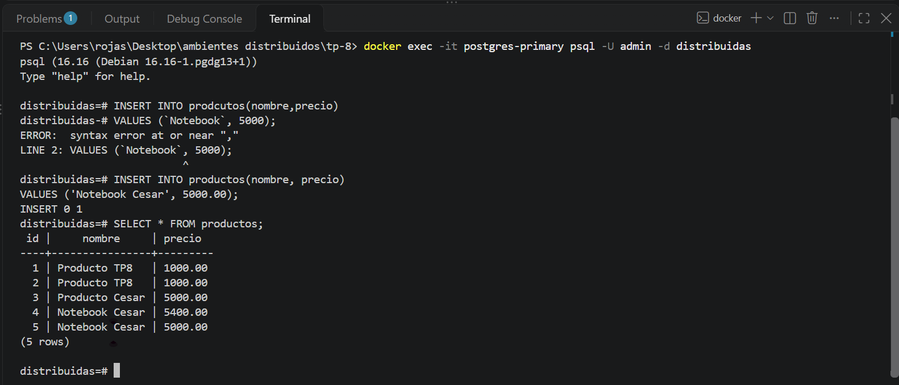
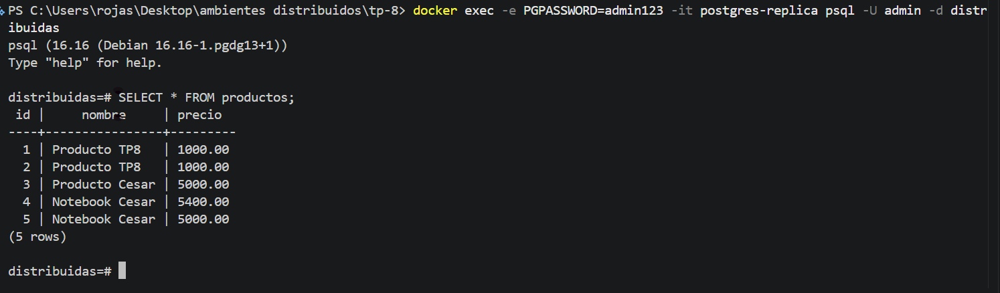
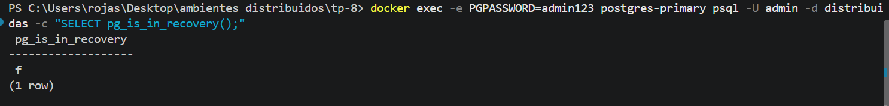
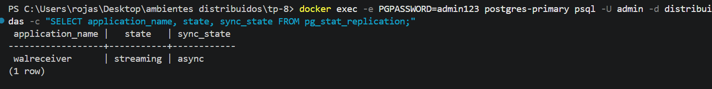
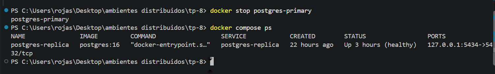
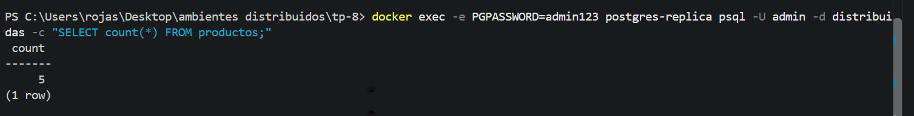

# TP8 - PostgreSQL 16 con streaming replication

# Trabajo Práctico N° 8
## Bases de Datos Distribuidas y Conexión entre Capas

### Materia
Desarrollo de Aplicaciones para Ambientes Distribuidos

### Docente
Lic. Gabriel Artaza

### Alumno
César Rojas

---

# Objetivo

Diseñar e implementar una arquitectura de persistencia distribuida utilizando PostgreSQL 16 con replicación mediante Streaming Replication, conectada a una aplicación backend desarrollada con Spring Boot.

La implementación permite:

- Escritura de datos sobre un nodo primario.
- Replicación automática hacia un nodo secundario.
- Lectura desde la réplica.
- Verificación de consistencia.
- Prueba de tolerancia a fallos ante la caída del nodo principal.

---

# Tecnologías Utilizadas

- Java 21
- Spring Boot
- PostgreSQL 16
- Docker
- Docker Compose
- JPA / Hibernate
- pgAdmin

---

# Arquitectura

```text
                    Spring Boot
                         │
                         │ Escrituras
                         ▼

                postgres-primary
                    (Primario)

                         │
                         │ WAL Streaming Replication
                         ▼

                postgres-replica
                    (Réplica)

                         ▲
                         │ Lecturas
## Capturas de evidencia TP8


1. `docker compose ps` con ambos servicios saludables.
2. Salida de `pg_is_in_recovery()` en ambos nodos: `false` en primary y `true` en replica.
3. `pg_stat_replication` en el primario y `pg_stat_wal_receiver` en la replica, ambos en `streaming`.
4. Comando/resultado del `INSERT` ejecutado en el primario y el `SELECT` equivalente con la fila en la replica.
5. Respuesta `201` del `POST /productos` y resultado de `GET /productos`.
6. Prueba de caida: primario detenido en `docker compose ps` y lectura satisfactoria desde la replica/API.

Si la catedra requiere nombres, encuadres o capturas adicionales, cotejar esta lista con la consigna antes de entregar.


Captura 1: Clúster de Base de Datos en ejecución'
[text](capturas/1ejecucion.png)

Comando PowerShell
docker compose ps
Debe verse
Plain Text
postgres-primary healthy
postgres-replica healthy

Clúster activo.


📸 Captura 2: Escritura en el Primario



Entrar al Primario
PowerShell
docker exec -e PGPASSWORD=admin123 -it postgres-primary psql -U admin -d distribuidas
Insertar un registro
SQL
INSERT INTO productos(nombre, precio)
VALUES ('Notebook Cesar', 5000.00);
Verificar
SQL
SELECT * FROM productos;
Debe verse algo similar
Plain Text
id | nombre | precio
----+-----------------+---------
1 | Notebook Cesar | 5000.00


📸 Captura 3: Lectura en la Réplica


Abrir otra terminal
PowerShell
docker exec -e PGPASSWORD=admin123 -it postgres-replica psql -U admin -d distribuidas
Verificar
SQL
docker exec -e PGPASSWORD=admin123 -it postgres-replica psql -U admin -d distribuidas
Debe aparecer el mismo registro
Plain Text
id | nombre | precio
----+-----------------+---------
1 | Notebook Cesar | 5000.00


📸 Captura 4: Verificar que la réplica es real




Primario
PowerShell
docker exec -e PGPASSWORD=admin123 postgres-primary psql -U admin -d distribuidas -c "SELECT pg_is_in_recovery();"
Resultado:
Plain Text
f
Réplica
PowerShell
docker exec -e PGPASSWORD=admin123 postgres-replica psql -U admin -d distribuidas -c "SELECT pg_is_in_recovery();"
Resultado:
Plain Text
t


📸 Captura 5: Replicación Streaming


Comando
PowerShell
docker exec -e PGPASSWORD=admin123 postgres-primary psql -U admin -d distribuidas -c "SELECT application_name, state, sync_state FROM pg_stat_replication;"
Debe verse
Plain Text
application_name | state | sync_state
-----------------+-----------+-----------
walreceiver | streaming | async


📸 Captura 6: Simulación de caída del Primario



Apagar el primario
PowerShell
docker stop postgres-primary
Verificar estado
PowerShell
docker compose ps
Debe verse
Plain Text
postgres-primary Exited
postgres-replica Up


📸 Captura 7: Lectura con el Primario caído



Consultar la réplica
PowerShell
docker exec -e PGPASSWORD=admin123 postgres-replica psql -U admin -d distribuidas -c "SELECT count(*) FROM productos;"
Debe responder algo como
Plain Text
count
-------
3
Demuestra que el sistema sigue permitiendo consultas desde la réplica aun cuando el primario está fuera de servicio


Implementacion minima de PostgreSQL primario/replica y una API Spring Boot para insertar productos en el primario y consultarlos desde el standby.

## Arquitectura

```text
Spring Boot
  POST /productos -> postgres-primary:5432 (JPA)
  GET  /productos -> postgres-replica:5434 (JDBC)

postgres-primary -- WAL streaming asincrono --> postgres-replica
```

La replica se crea desde una copia fisica del primario mediante `pg_basebackup -R`. Esto genera `standby.signal` y la configuracion para recibir WAL del primario. El script inicia el standby con `hot_standby=on`; en recovery, `pg_is_in_recovery()` devuelve `true` y se permiten consultas de solo lectura.

## Archivos

- `docker-compose.yml`: nodos PostgreSQL 16, healthchecks, puertos y volumenes.
- `postgresql.conf`: `wal_level=replica`, `max_wal_senders`, `wal_keep_size` y `hot_standby`.
- `pg_hba.conf`: autenticacion SCRAM para conexiones y replicacion.
- `init.sql`: crea el usuario `replicator` y la tabla `productos` al inicializar un primario nuevo.
- `scripts/init-replica.sh`: inicializa el standby con `pg_basebackup` y configura su archivo de contrasenas para reconectar.
- `src/main/java`: entidad, repository JPA, service y controller de productos.

Las credenciales del compose (`admin/admin123` y `replicator/replicator123`) son solo para desarrollo local.

## Arrancar

Requisitos: Docker Compose, Java 21 y Maven Wrapper.

Esta carpeta ya tenia contenedores llamados `postgres-primary` y `postgres-replica`. Antes del primer arranque de esta configuracion, liberar esos nombres. Estos comandos eliminan los contenedores, pero no sus volumenes:

```powershell
docker stop postgres-primary postgres-replica
docker rm postgres-primary postgres-replica
docker compose up -d
docker compose ps
```

Si Docker informa que los volumenes de esta configuracion contienen datos antiguos, respaldarlos antes de eliminarlos. Para empezar desde cero (borra permanentemente los volumenes de este proyecto):

```powershell
docker compose down -v
docker compose up -d
docker compose ps
```

`init.sql` se ejecuta solamente cuando el primario inicializa un directorio de datos vacio. El script de la replica toma la copia inicial solamente si su `PGDATA` no tiene `PG_VERSION`; no borra ni pisa directorios existentes.

## Verificar roles y streaming

En el primario debe dar `false`; en la replica, `true`:

```powershell
docker exec -e PGPASSWORD=admin123 postgres-primary psql -U admin -d distribuidas -c "SELECT pg_is_in_recovery(), current_setting('wal_level');"
docker exec -e PGPASSWORD=admin123 postgres-replica psql -U admin -d distribuidas -c "SELECT pg_is_in_recovery(), current_setting('hot_standby');"
```

Verificar ambos lados del flujo WAL:

```powershell
docker exec -e PGPASSWORD=admin123 postgres-primary psql -U admin -d distribuidas -c "SELECT application_name, state, sync_state FROM pg_stat_replication;"
docker exec -e PGPASSWORD=admin123 postgres-replica psql -U admin -d distribuidas -c "SELECT status, sender_host FROM pg_stat_wal_receiver;"
```

Esperar a que `state` y `status` muestren `streaming`.

## Demostrar propagacion de INSERT

Insertar en el primario y consultar el mismo registro en la replica:

```powershell
docker exec -e PGPASSWORD=admin123 postgres-primary psql -U admin -d distribuidas -c "INSERT INTO productos (nombre, precio) VALUES ('Prueba TP8 replicacion', 1250.00);"
Start-Sleep -Seconds 2
docker exec -e PGPASSWORD=admin123 postgres-replica psql -U admin -d distribuidas -c "SELECT id, nombre, precio FROM productos WHERE nombre = 'Prueba TP8 replicacion' ORDER BY id DESC LIMIT 1;"
```

La replicacion es asincrona: la replica puede tardar brevemente en mostrar el commit.

## API Spring Boot

En una terminal:

```powershell
.\mvnw.cmd spring-boot:run
```

En otra terminal, crear un producto (HTTP `201`) y leerlo desde la replica:

```powershell
$body = @{ nombre = "Producto desde Spring"; precio = 1499.90 } | ConvertTo-Json
$response = Invoke-WebRequest -Method Post -Uri "http://localhost:8080/productos" -ContentType "application/json" -Body $body
$response.StatusCode
$response.Content
Start-Sleep -Seconds 2
Invoke-RestMethod -Uri "http://localhost:8080/productos"
```

El `POST` escribe por JPA en el primario; el `GET` consulta directamente la replica. Si se consulta inmediatamente tras insertar, esperar la propagacion asincrona.

## Prueba de caida del primario

Con la aplicacion y ambos nodos activos, detener el primario:

```powershell
docker stop postgres-primary
docker compose ps
docker exec -e PGPASSWORD=admin123 postgres-replica psql -U admin -d distribuidas -c "SELECT pg_is_in_recovery(); SELECT count(*) FROM productos;"
Invoke-RestMethod -Uri "http://localhost:8080/productos"
```

La replica sigue atendiendo lecturas de los datos que recibio. El primario esta detenido y las escrituras fallan; esta configuracion **no hace failover ni promocion automatica**. No promover la replica ni arrancar ambos nodos como primarios. Para restaurar la prueba sin promover:

```powershell
docker start postgres-primary
docker compose ps
```
